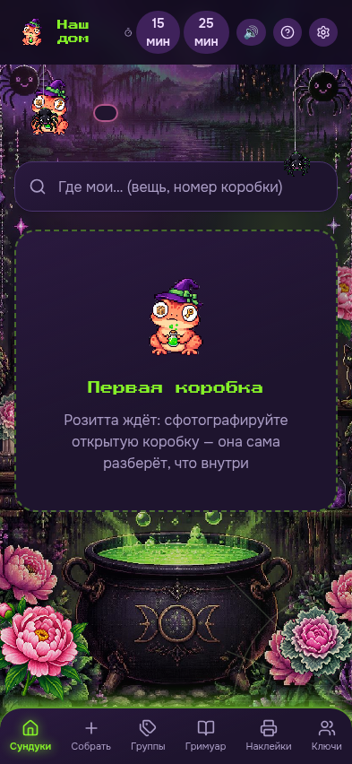
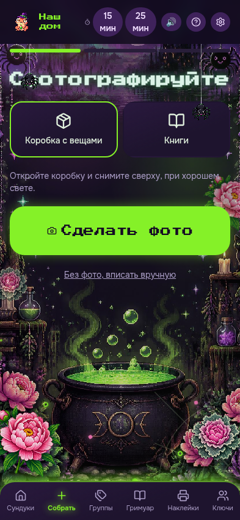
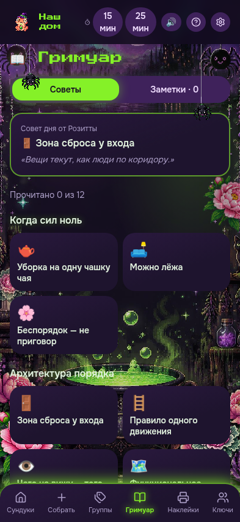
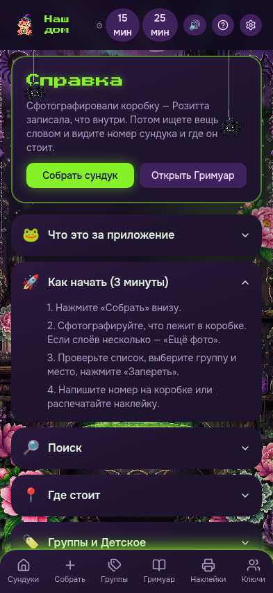
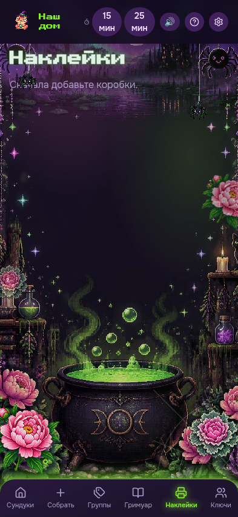

# 🐸 Тайные Хроники Топей Розитты

### Rozitta’s Mires

_The Secret Chronicles of Rozitta’s Mires_

**Опись коробок, сундуков и кладовок для тех, кто устал искать вещи — в неоновом ведьмином болоте**

_«Где зимние сапоги? — В сундуке №7, на балконе.»_

Без регистрации · Фото → список вещей · QR-наклейки · Общий доступ для семьи

---

## Зачем это нужно

Вещи, которые не видно, для уставшей головы не существуют. А вытряхивать пять коробок ради одной зарядки — нет сил.

- **Сфотографировали — записано.** Розитта сама разбирает фото и составляет список вещей. Можно снимать слоями: дно, середина, верх.
- **Нашли словом.** «Сапоги», «зима», «балкон» — и сразу видно номер сундука и место.
- **Одно действие на экран.** Короткие шаги, крупные кнопки, таймер на 15/25 минут.
- **Без чувства вины.** Есть «Тайничок на потом» и Гримуар с советами, что делать, когда сил ноль.
- **Красиво.** Пиксельная жаба-архивариус, котёл с зельем, паучки, пионы и капуста. Скучное должно радовать.

## Как это выглядит

  
  
  

  
  

<i>Сундуки · Собрать · Гримуар · Справка · Наклейки</i>

## Что умеет

| Раздел | Что внутри |
| --- | --- |
| **Сундуки** | Поиск по вещам, номеру, группе, месту, сезону и размеру. Розитта ворчит в облачке |
| **Новый сундук** | Фото → список вещей → группа → «Где стоит». До 5 снимков: «Добавить фото» сохраняет снимок, «Распознать новое фото» дополняет список |
| **Метки вещей** | ИИ сам ставит каждой вещи метку; облако меток в «Доме» показывает, чего сколько и где лежит; цвет меток можно сменить |
| **Группы** | Создание прямо в сундуке, редактирование в ☰ → «Настройки». Цвет и значок, «Детское» с возрастом и сезоном, «Тайничок на потом» с датой |
| **Гримуар** | 12 коротких советов о порядке глазами архитектора и общие заметки дома |
| **Наклейки** | PDF на листе A4 или термоэтикетках 50×30 / 40×30 / свой размер. Стили «Фирменный», «Простой» (ч/б для термопринтера), «Изумрудный крафт» и «Тёплый шоколад» (для цветной печати, жабка в центре QR); на наклейке номер, список вещей или фото; предпросмотр, «Напечатать» и PNG для приложения принтера (несколько — одним ZIP) |
| **Сканер** | Кнопка-камера в шапке: навели на QR наклейки — открылся сундук |
| **Где стоит** | Путь через слэш показывается цепочкой: 📍 Гараж → Стеллаж → Полка 3. Кнопка «Переставить» в сундуке меняет только место |
| **Срок годности** | Отметки «Осталось 5 дн.» / «Срок прошёл» на карточке сундука |
| **Дом** | Комнаты на выбор (фонотека, мастерская, детская, гараж…): сундуки попадают туда по полю «Где стоит»; в Оранжерее — полив |
| **Таинственный сад** | Необязательный раздел в меню: золотой ключ, дверь с плющом, ярусные посадки и бережный коуч |
| **Копия** | JSON и CSV, восстановление из JSON, напоминание раз в месяц |
| **Ключи** | Ссылка или QR, по которым семья входит в общий дом |
| **Справка** | Плитки-переходы в разделы и короткие раскрывающиеся ответы с кнопкой «перейти» |

Удалили сундук случайно — 7 секунд горит кнопка «Вернуть».

### Новый год

Снег и ёлка в фоне главной появляются автоматически с 15 декабря по 14 января, без оповещения.

### Сад за дверью

☰ → **«Таинственный сад»** — необязательный уголок: за любое дело для порядка («Засчитать шаг») вырастает новое растение (после 16 шагов арка ведёт во вторую комнату — огород потаже), Розитта подсказывает короткие шаги. Ничего не вянет; прогресс хранится в браузере (`src/lib/garden.ts`, `src/lib/coach.ts`).

## Приватность

- **Нет логинов и паролей.** Дом открывается секретным ключом-ссылкой. Кто знает ссылку, видит и меняет всё — не публикуйте её.
- **Доступ проверяет база.** Данные читаются только функциями, которые сверяют ключ дома. Фото лежат в закрытом хранилище, по папке на дом.
- **Ключ ИИ хранится только в браузере** и отправляется напрямую в выбранный сервис.

## Распознавание фото

В ☰ → «Настройки» → «Распознавание фото» выберите сервис, вставьте ключ и модель. Начало ключа подскажет сервис:

| Ключ начинается с | Сервис |
| --- | --- |
| `AIza…` | Google Gemini Flash (бесплатный лимит в Google AI Studio, из России нужен VPN) |
| `sk-myapi_…` | Claude n Codex |
| `sk-or-…` | OpenRouter |

Ещё можно подключить свою модель на компьютере (LM Studio, Ollama — любой OpenAI-совместимый адрес).

Без ключа работает **«Вставить список»**: сфотографируйте сундук в любом ИИ-чате, скопируйте ответ, вставьте — каждая строка станет вещью.

DeepSeek не подходит: он не видит картинки.

## Обновления и резервная копия

- **Обновляться просто:** новая версия приходит сама — Розитта покажет «Обновить». Номер версии внизу меню ☰.
- **Не удаляйте приложение и данные сайта** ради обновления: в браузере хранится ключ дома.
- Залипло на старой версии? ☰ → «Копия и обновления» → **«Начисто»**. Дом и ключи сохранятся.
- Там же — **копия** в JSON/CSV и **«Восстановить из копии»** (добавляет, ничего не удаляя). Раз в месяц Розитта напомнит.
- Для разработчика: номер версии — `APP_VERSION` в `src/lib/updates.ts`.

## История версий

- **1.6.0** — Компьютер и навигация: боковое меню, стрелка «Назад», «Подключить телефон», один шаг съёмки.
- **1.5.0** — До 5 фото на сундук, комнаты дома, интерьерные наклейки, ZIP с PNG.
- **1.4.0** — Таинственный сад, шаги к порядку, ночь по времени, огород Потаже.
- **1.3.0** — Значки, путь до сундука, сроки, QR-сканер.
- **1.2.0** — Выбор моделей ИИ, печать наклеек, копия JSON/CSV, статическая сборка.
- **1.1.0** — Ворчалки Розитты, Гримуар, новогоднее оформление.
- **1.0.0** — Сундуки, распознавание фото, семья по ссылке-ключу.

Новую версию поднимаем при заметных изменениях: запись в `src/lib/changelog.ts`, `package.json` и бейдж выше.

## Как настроить под себя

Всё, что говорит Розитта, лежит в одном файле **`src/lib/quotes.ts`** — программировать не нужно.

1. Откройте репозиторий на github.com → `src/lib/quotes.ts`.
2. Нажмите карандаш ✏️ (Edit this file).
3. Допишите строку в кавычках с запятой в конце: `"Моя фраза",`
4. Нажмите **Commit changes**. Хостинг сам пересоберёт сайт за минуту.

| Что поменять | Где |
| --- | --- |
| Фразы в облачке на главной | `ROZITTA_QUOTES` в `src/lib/quotes.ts` |
| Фразы, пока Розитта смотрит фото | `BREWING_QUOTES` в `src/lib/quotes.ts` |
| Советы Гримуара | `src/lib/grimoire.ts` |
| Разделы справки | `src/lib/guide.ts` |

Если сборка упала — скорее всего, потерялась кавычка или запятая.

## Установка на свой Supabase + Layero

1. **Supabase.** Создайте проект → SQL Editor → вставьте весь `supabase-setup.sql` → Run.
2. Скопируйте **Project URL** и **anon public key** (Project Settings → API).
3. **GitHub.** Выгрузите проект в свой репозиторий.
4. **Layero.** Подключите репозиторий:
   - сборка: `STATIC_BUILD=1 bun run build`
   - папка с сайтом: обычно **`dist/client`**; если её нет, сборка кладёт сайт в **`.output/public`**. Укажите ту, где после сборки лежит `index.html` — скрипт в конце сборки пишет, какую именно (`static site ready in …`)
   - для любых адресов (`/box/…`, `/b/…`, `/join/…`) сервер должен отдавать `index.html` — включите «SPA / fallback на index.html»; в папке уже есть `404.html` и `_redirects` для хостингов, которые понимают их сами
   - переменные окружения:

   | Переменная | Значение |
   | --- | --- |
   | `VITE_SUPABASE_URL` | Project URL |
   | `VITE_SUPABASE_PUBLISHABLE_KEY` | anon public key |
5. Откройте сайт → ☰ → «Настройки» → «Распознавание фото» → вставьте ключ и выберите модель. Без него на Layero распознавание не работает.

## Стек

React 19 · TanStack Start · Tailwind CSS 4 · Supabase (Postgres-функции + Storage) · jsPDF + QR

---

Сделано с любовью к жабам, капусте и сказкам Софьи Прокофьевой 🐸🥬

